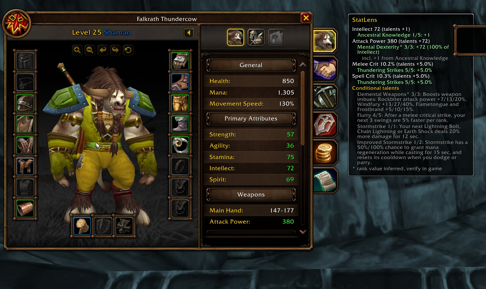
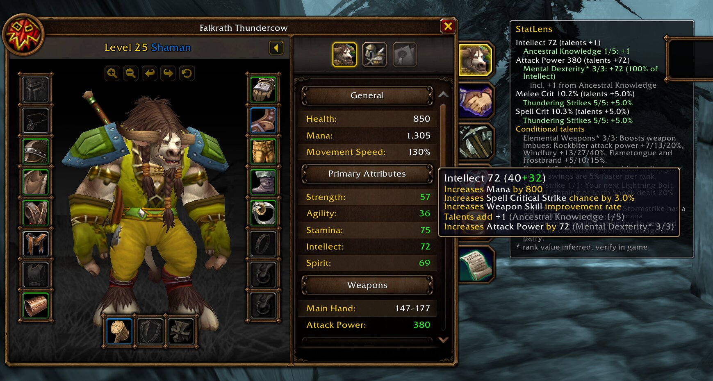
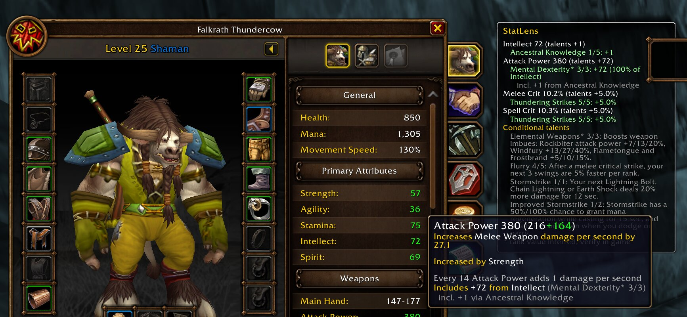
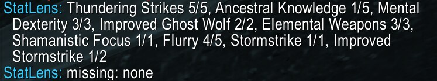

# StatLens

WoW: Forever addon that explains how your talents change your character stats.

Supported: Shaman, Druid and Warrior, all three talent trees each. enUS client, Interface 16001 (beta build 1.60.1.70338).

Talents that change character sheet stats:

| Class | Tree | Talents |
| --- | --- | --- |
| Shaman | Elemental Combat | none (all spell-specific) |
| Shaman | Enhancement | Thundering Strikes, Ancestral Knowledge, Mental Dexterity, Anticipation, Toughness, Spirit Weapons, Mental Quickness |
| Shaman | Restoration | Tidal Focus (hit), Improved Reincarnation (health) |
| Druid | Balance | Nature's Majesty, Nature's Reach (hit), Moonkin Form (crit aura) |
| Druid | Feral Combat | Heart of the Wild, Feral Swiftness, Thick Hide, Sharpened Claws, Predatory Strikes, Leader of the Pack, Natural Instinct, Natural Reaction |
| Druid | Restoration | Living Spirit (Spirit) |
| Warrior | Arms | Deflection (parry), Weaponmaster (crit with an Axe or Polearm) |
| Warrior | Fury | Cruelty (crit) |
| Warrior | Protection | Shield Specialization (block with a shield), Anticipation (defense, plus 0.04% dodge, parry and block per point) |

Every other talent is listed too, so its tooltip explains it even though it does not change the sheet.

Party auras (Leader of the Pack, Moonkin Form) are attributed to your talent; if a groupmate provides the same aura, the client total already includes it.

Conditional talents depend on your form (Druid) or equipment (Warrior main-hand weapon type, shield). When the condition is not met, the effect is shown in grey with its value under that condition, and it is not counted in the talent total.

Anticipation's 0.04% per Defense point is the Classic rule and is not yet confirmed on Forever.

## What it shows

- **Character panel** next to the character window: each stat with the talents that contribute to it, including chained effects (for example, Ancestral Knowledge raises Intellect, which Mental Dexterity turns into Attack Power).
- **Talent tooltips**: what the talent gives you now and what the next point would add, using your current stats.
- **Character stat tooltips**: hovering a stat row (Intellect, Attack Power, ...) appends the talents behind it, in the native tooltip style.
- **Form-gated talents** (Druid): effects that only apply in Cat, Bear or Moonkin Form are shown in grey with their value in that form while you are in another form.
- **Conditional talents** (Flurry, Maelstrom Weapon, Stormstrike, ...) are explained, not measured: they do not change the character sheet.

Values marked `*` use inferred per-rank numbers (only rank 1 and max rank were published). Verify them in game.

## Screenshots

Taken on the WoW: Forever beta with a level 25 Enhancement Shaman.

**Character panel**: each stat with the talents behind it, including the Ancestral Knowledge -> Intellect -> Attack Power chain.



**Native stat tooltips**: talent lines appended to the game's own tooltip.





**`/sl talents`**: talents detected from the client.



## Combat

WoW: Forever inherits Midnight's addon restrictions: in combat many values are secret. StatLens never computes on secret values; the panel freezes and dims in combat, and tooltips show `unavailable in combat`.

## How the math works

The client reports final totals, with talents already applied. StatLens inverts them:

- Percent talents: `base = total / (1 + p)`, contribution `= total - base`.
- Stat-from-stat talents: `ratio x source total`. The share coming from a percent talent on the source stat is shown as an `incl.` line.
- Flat talents (crit, dodge): the per-rank value.
- Per-level talents (Predatory Strikes, Thick Hide): `ratio x level`.
- Inactive form effects are hypothetical: computed on your current stats, never counted in the talent total.

Thick Hide only counts base armor per level; the defense-skill bonus and form armor multipliers are not included, so in Bear Form its share is understated.
Assumption: talent percentages multiply the buffed stat. If the client stacks them differently, numbers drift slightly.

## Commands

| Command | Effect |
| --- | --- |
| `/sl help` | List commands |
| `/sl talents` | Print detected talent ranks, missing and unmatched talents |
| `/sl panel` | Toggle the character panel |
| `/sl offset <n>` / `/sl offset auto` | Move the panel manually / back to automatic placement |
| `/sl form` | Print the raw shapeshift form id and its mapped name |
| `/sl tooltip` | Toggle tooltip lines |
| `/sl debug` | Toggle debug output |

## Install (Linux / Wine)

```sh
ln -s ~/Projects/StatLens \
  "$HOME/Games/battlenet/drive_c/Program Files (x86)/World of Warcraft/_classic_beta_/Interface/AddOns/StatLens"
```

## Development

```sh
lua5.1 tests/run.lua
```

Talent data lives in `Data/Shaman.lua`. Logic (`Calc.lua`, `Format.lua`) is pure and covered by tests; frames (`Panel.lua`, `Tooltip.lua`) are thin.

## In-game verification checklist

1. Addon loads with no Lua error (`/console scriptErrors 1`).
2. `/sl talents` lists your taken talents with correct ranks; `missing` and `unmatched` are empty.
3. Character window opens with the StatLens panel on its right.
4. Intellect: unequip or remove a buff and confirm the Ancestral Knowledge share changes as expected.
5. Mental Dexterity: Attack Power part equals the shown share of Intellect (confirms the rank-2 value if you are at 2/3).
6. Thundering Strikes: crit share matches ranks.
7. Hover a talent: `Now` and `Next point` lines appear once (not duplicated).
8. Spend a point: panel and tooltip refresh.
9. Enter combat: panel dims with `Frozen in combat`; leaving combat refreshes it.
